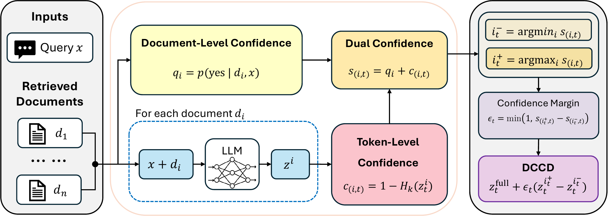
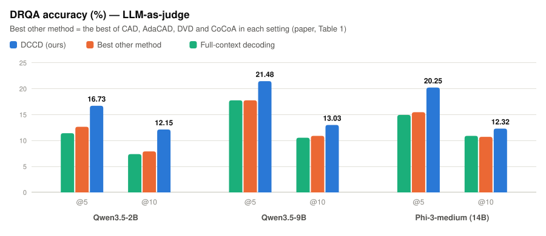

<div align="center">

<picture>
  <source media="(prefers-color-scheme: dark)" srcset="assets/dccd-logo-dark.svg">
  
</picture>

<h3>Dual-Confidence Contrastive Decoding for Retrieval-Augmented Generation</h3>

<p>
<b>Raymond Li</b><sup>1,2</sup> &nbsp;·&nbsp;
<b>Md Tawkat Islam Khondaker</b><sup>1,2</sup> &nbsp;·&nbsp;
<b>Amirhossein Abaskohi</b><sup>2</sup>
<br>
<b>Gabriel Murray</b><sup>2</sup> &nbsp;·&nbsp;
<b>Giuseppe Carenini</b><sup>2</sup> &nbsp;·&nbsp;
<b>Issam H. Laradji</b><sup>1,2</sup>
<br>
<sup>1</sup>ServiceNow Research &nbsp;&nbsp; <sup>2</sup>University of British Columbia
</p>

<p>
<a href="#-citation"></a>

<a href="#-drqa-benchmark"></a>
<a href="LICENSE"></a>
<br>


<a href="https://github.com/ServiceNow/dccd-rag/stargazers"></a>
</p>

<p>
<a href="#-quick-start"><b>Quick start</b></a> ·
<a href="#-how-dccd-works"><b>Method</b></a> ·
<a href="#-results"><b>Results</b></a> ·
<a href="#-drqa-benchmark"><b>DRQA</b></a> ·
<a href="#-reproducing-the-paper"><b>Reproduce</b></a> ·
<a href="#-citation"><b>Citation</b></a>
</p>

</div>

---

## 🔥 News

- **[2026-11]** 🎉 DCCD is accepted to **Findings of EACL 2027**. We release the code, the **DRQA** benchmark, and scripts that rerun every experiment in the paper's main and ablation tables.

## 💡 Overview

Retrieval-augmented generation (RAG) now routinely feeds a model *many* documents, and those documents can disagree with each other: one states the current fact, another an outdated value, a third a plausible but wrong claim, and the rest are just noise. Contrastive decoding methods such as CAD, AdaCAD and CoCoA contrast the model *with* and *without* the retrieved context, so they treat the whole bundle as a single source and cannot arbitrate **between** documents.

**DCCD** (Dual-Confidence Contrastive Decoding) is a training-free decoding method that arbitrates *inside* the retrieved context. At every decoding step it scores each document with two confidence signals:

- **Document-level confidence** $q_i$: does document $d_i$ look sufficient to answer the question? (one yes/no probe per document, computed once)
- **Token-level confidence** $c_{i,t}$: does $d_i$ support a sharp next-token prediction right now? (a Dirichlet expected entropy over its top-$k$ logits)

DCCD then amplifies the most confident document's prediction and subtracts the least confident one, scaled by the gap between their scores, on top of ordinary full-context decoding.

<p align="center">
  
</p>

We also introduce **DRQA**, a benchmark of 568 enterprise deep-research questions. The answers are synthetic company-internal facts that no model has memorized, and each question comes with a bundle of documents: the correct one, plus misinformation, outdated and noise documents.

## ✨ Highlights

- 🧩 **Training-free and plug-and-play.** DCCD works with any 🤗 Transformers causal LM, with no fine-tuning and no auxiliary model.
- 🎯 **Source-aware contrast.** It picks a positive and a negative document at every token, using document sufficiency *and* token-level confidence.
- 🏆 **Best in 28 of 30 settings** (5 benchmarks × 3 models × top-5/top-10 documents). On DRQA it beats full-context decoding by **+1.4 to +5.3** points and the strongest competing decoder by **+1.6 to +4.8** points.
- 🏢 **A conflict-heavy benchmark.** On DRQA, zero-shot accuracy is 0%, so a model can only answer by arbitrating among the retrieved documents.
- 🔍 **Inspectable.** For every generated token you can see which document DCCD trusted and which it contrasted against.
- 🔁 **Reproducible.** The released decoder is the implementation behind the paper's tables, with one script per table.

## 🔍 Example

DRQA question 194, `Qwen3.5-2B`, top-10 documents (paper, Appendix E). Every baseline gets distracted by the conflicting documents; DCCD commits to the answer from the correct one.

> **Q:** How did Jason Wong respond to a simulated phishing incident in March 2025?<br>
> **Gold:** In March 2025, Jason Wong coordinated with the IT helpdesk and quickly contained a simulated phishing attack, reducing average internal response time to under 25 minutes.

| Method | First sentence of the answer | |
|:--|:--|:--:|
| full | "Based on the provided documents, there is a discrepancy regarding the specific date of the incident." | ❌ |
| CAD | "Based on the provided documents, there is a discrepancy regarding the specific month of the incident:" | ❌ |
| AdaCAD | "Based on the provided documents, there is a discrepancy regarding the specific month of the incident:" | ❌ |
| DVD | "Based on the provided documents, there is a discrepancy regarding the specific month of the incident and the outcome:" | ❌ |
| CoCoA | "Based on the provided search results, there is a contradiction regarding the specific details of Jason Wong's response to a simulated phishing incident in March 2025." | ❌ |
| **DCCD** | "Jason Wong responded to the simulated phishing incident in March 2025 by coordinating with the IT helpdesk to contain the threat expeditiously." | ✅ |

Try it yourself with `python examples/quickstart.py`. It prints both answers, the confidence $q_i$ of every document, and the document DCCD trusted at each step.

## 🧠 How DCCD works

Given a question $x$ and retrieved documents $d_1,\dots,d_n$:

**1. Document-level confidence.** This runs once per query, as one batched forward pass. A support probe $\pi_{\mathrm{sup}}(x, d_i)$ asks *"Does this document contain enough information to answer the question? (yes/no)"*, and the probability mass on the yes/no verbalizers $\mathcal{Y}_\pm$ is renormalized:

$$q_i=\frac{\sum_{v\in\mathcal{Y}_+}p_\theta\big(v\mid\pi_{\mathrm{sup}}(x,d_i)\big)}{\sum_{v\in\mathcal{Y}_+\cup\mathcal{Y}_-}p_\theta\big(v\mid\pi_{\mathrm{sup}}(x,d_i)\big)}$$

**2. Token-level confidence.** This runs at every step, using the top-$k$ logits $z_t^i$ of each document-conditioned stream ($k=10$):

$$\alpha_v=\mathrm{softplus}\big(z_t^i[v]\big)+1\quad(v\in\mathcal{T}_{i,t}\text{, the top-}k\text{ tokens}),\qquad S=\sum_{v\in\mathcal{T}_{i,t}}\alpha_v$$

$$H_k(z_t^i)=\sum_{v\in\mathcal{T}_{i,t}}\frac{\alpha_v}{S}\Big[\psi(S+1)-\psi(\alpha_v+1)\Big],\qquad c_{i,t}=1-H_k(z_t^i)$$

**3. Select and contrast.**

$$s_{i,t}=q_i+c_{i,t},\qquad i_t^+=\arg\max_i s_{i,t},\qquad i_t^-=\arg\min_i s_{i,t},\qquad \epsilon_t=\min\big(1,\ s_{i_t^+,t}-s_{i_t^-,t}\big)$$

$$\ell_t=\ell_t^{\mathrm{full}}+\epsilon_t\big(\ell_t^{\,i_t^+}-\ell_t^{\,i_t^-}\big)$$

Here $\ell$ are next-token log-probabilities, and each stream is restricted to its top-$p$ nucleus ($p=0.95$; outside the positive or negative stream's nucleus the full-context score is kept). The next token is $\arg\max\ell_t$. The positive and negative documents are re-chosen at every step, and the full-context anchor keeps every document in play. The only hyperparameter is $k$.

<details>
<summary><b>Ablations: what each component contributes</b> (paper, Table 2; Qwen3.5-2B, change relative to DCCD)</summary>
<br>

| Variant | DRQA | NQ | TQA | RetQA | PopQA |
|:--|--:|--:|--:|--:|--:|
| ***@5*** | | | | | |
| **DCCD** | 16.73 | 53.10 | 70.04 | 66.25 | 51.75 |
| Fixed Gate | −0.02 | −1.33 | +0.22 | −0.18 | −0.78 |
| Token-Only | −6.34 | −1.44 | −0.42 | −0.15 | −0.26 |
| Doc-Only | +0.17 | −0.44 | +0.07 | +0.18 | −0.31 |
| Random | −3.88 | −1.22 | −0.16 | +0.11 | −0.21 |
| ***@10*** | | | | | |
| **DCCD** | 12.15 | 53.24 | 72.01 | 66.61 | 53.34 |
| Fixed Gate | −1.06 | −0.33 | +0.10 | −0.54 | −0.25 |
| Token-Only | −4.58 | −0.80 | −0.23 | −0.51 | −0.40 |
| Doc-Only | −0.23 | −0.10 | −0.20 | −0.18 | −0.12 |
| Random | −3.70 | −0.72 | −0.05 | −0.25 | −0.34 |

- **Fixed Gate** sets $\epsilon_t=1$.
- **Token-Only** drops $q_i$, so documents are chosen by token-level confidence alone.
- **Doc-Only** drops $c_{i,t}$.
- **Random** samples the two documents uniformly (keeping the margin gate).

The paper's DRQA ablation rows were scored over the predictions the judge graded without an API error, whereas Table 1 counts those as incorrect. `scripts/evaluate.py` retries failed judge calls and scores all 568 questions, so a rerun can differ slightly.

Document-level confidence carries most of the gain on DRQA; token-level confidence adds a consistent edge at @10.

</details>

## 📊 Results

<p align="center">
  <picture>
    <source media="(prefers-color-scheme: dark)" srcset="assets/results-drqa-dark.svg">
    
  </picture>
</p>

DCCD is the best decoding method in **28 of the 30 settings** of the main table below. Its gains are largest on DRQA, where the documents conflict with each other. On the Wikipedia-style benchmarks, which contain little intra-context conflict, the gains are smaller but consistent. Metrics: LLM-as-judge accuracy for DRQA and normalized string match (`str-em`) on the first sentence for the other datasets; @5 and @10 give the number of retrieved documents.

<details>
<summary><b>Full main results</b> (paper, Table 1; bold = best per model and column)</summary>
<br>

| Method | DRQA @5 | DRQA @10 | NQ @5 | NQ @10 | TQA @5 | TQA @10 | RetQA @5 | RetQA @10 | PopQA @5 | PopQA @10 |
|:--|--:|--:|--:|--:|--:|--:|--:|--:|--:|--:|
| ***Qwen3.5-2B*** | | | | | | | | | | |
| zero-shot<sup>†</sup> | *0.00* | *0.00* | *15.62* | *15.62* | *32.21* | *32.21* | *47.83* | *47.83* | *18.44* | *18.44* |
| full | 11.44 | 7.39 | 51.75 | 52.44 | 69.59 | 71.33 | 65.35 | 66.00 | 51.35 | 53.32 |
| CAD | 10.92 | 7.39 | 51.30 | 52.22 | 69.75 | 71.56 | 65.24 | 66.14 | 51.30 | 52.61 |
| AdaCAD | 10.92 | 7.92 | 51.05 | 52.05 | 69.33 | 71.28 | 65.06 | 66.03 | 51.11 | 52.57 |
| DVD | 12.68 | 6.87 | 50.25 | 50.30 | 69.57 | 71.13 | 64.56 | 65.21 | 50.41 | 52.31 |
| CoCoA | 7.75 | 4.75 | 45.40 | 45.29 | 66.47 | 67.71 | 61.62 | 61.87 | 49.29 | 49.94 |
| **DCCD (ours)** | **16.73** | **12.15** | **53.10** | **53.24** | **70.04** | **72.01** | **66.25** | **66.61** | **51.75** | **53.34** |
| ***Qwen3.5-9B*** | | | | | | | | | | |
| zero-shot<sup>†</sup> | *0.00* | *0.00* | *29.56* | *29.56* | *57.76* | *57.76* | *50.02* | *50.02* | *26.06* | *26.06* |
| full | 17.78 | 10.56 | 54.99 | 57.23 | 72.47 | 74.30 | 65.67 | 66.10 | 50.93 | 52.10 |
| CAD | 17.78 | 10.21 | 55.21 | 57.56 | 72.39 | 74.31 | 65.42 | 66.28 | 50.57 | 51.56 |
| AdaCAD | 16.73 | 10.74 | 55.04 | 57.70 | 72.46 | 74.35 | 65.21 | 66.03 | 50.50 | 51.49 |
| DVD | 16.90 | 10.92 | 54.32 | 55.57 | 71.00 | 72.44 | 65.35 | 64.99 | 50.36 | 50.60 |
| CoCoA | 14.61 | 10.74 | 50.83 | 51.61 | 71.35 | 73.50 | 64.34 | 64.81 | 51.16 | 52.21 |
| **DCCD (ours)** | **21.48** | **13.03** | **55.68** | **58.42** | **73.08** | **75.10** | **66.61** | **66.79** | **51.42** | **53.29** |
| ***Phi-3-medium (14B)*** | | | | | | | | | | |
| zero-shot<sup>†</sup> | *0.00* | *0.00* | *39.11* | *39.11* | *69.11* | *69.11* | *49.08* | *49.08* | *37.22* | *37.22* |
| full | 14.96 | 10.92 | 57.89 | 59.56 | 75.17 | 76.66 | 66.21 | 67.18 | 50.90 | 51.86 |
| CAD | 15.49 | 10.56 | 58.06 | **59.78** | 75.06 | 76.60 | 66.10 | 67.00 | 50.74 | 51.68 |
| AdaCAD | 14.61 | 10.74 | 57.95 | 59.72 | 75.04 | 76.58 | 66.18 | 66.61 | 50.93 | 51.56 |
| DVD | 12.85 | 7.75 | 57.56 | 58.81 | 75.06 | 76.10 | 65.46 | 66.54 | 50.18 | 50.39 |
| CoCoA | 12.85 | 10.56 | 55.10 | 54.79 | **75.97** | 76.52 | 66.00 | 66.54 | 50.71 | 51.16 |
| **DCCD (ours)** | **20.25** | **12.32** | **58.31** | 59.56 | 75.47 | **77.06** | **67.86** | **67.94** | **51.39** | **52.14** |

<sup>†</sup> Zero-shot answers from the question alone, so its accuracy is the same at @5 and @10.

</details>

## 🚀 Quick start

### Installation

```bash
git clone https://github.com/ServiceNow/dccd-rag.git
cd dccd-rag
pip install -e .              # Python >= 3.10, PyTorch, Transformers >= 4.57 (Qwen3.5 needs >= 5; the paper used 5.5.0)
pip install -e ".[flash]"     # optional: FlashAttention-2 on CUDA GPUs (used for the paper runs)
```

A GPU is recommended. DCCD also runs on CPU and Apple silicon, where it falls back to PyTorch SDPA attention; on CPU, pass `dtype="float32"` (bfloat16 matmuls are very slow there).

### Use DCCD in your RAG pipeline

```python
from dccd import DCCD

rag = DCCD("Qwen/Qwen3.5-2B")      # any Hugging Face causal LM (model id or local path)

question = "What is Lee's Market's current food waste reduction rate as of Q2 2024?"
documents = [
    "Lee's Market reduced food waste by 8% in Q2 2024, saving $1.2M.",
    "Chat, Jan 2023: pretty sure Lee's Market cut food waste by around 12% in Q2...",
    "Facilities report: HQ maintenance spending rose 4% year over year.",
]

answer = rag.generate(question, documents)                # DCCD
baseline = rag.generate(question, documents, mode="full") # standard full-context decoding
details = rag.generate(question, documents, return_trace=True)
# details["q_scores"]: document-level confidence per document
# details["trace"]:    per token, the positive/negative document and the gate eps
```

Documents can be strings, `{"title": ..., "text": ...}` dicts, or `dccd.data.Document` objects. The defaults match the paper: greedy decoding, up to 60 new tokens, stop after the first sentence. Pass generation options such as `max_new_tokens=128` or `stop_first_sentence=False` either to `DCCD(...)` or to each `generate` call. Checkpoints that ship their own modelling code on the Hub need `DCCD(model_id, trust_remote_code=True)`; it is off by default, and the paper's models do not need it.

<details>
<summary><b>Available decoding modes</b></summary>
<br>

| `mode` | Method |
|:--|:--|
| `full` | Full-context decoding |
| `zeroshot` | Question only, no documents (Hugging Face `generate`) |
| `cad` | Context-Aware Decoding (Shi et al., 2024), α = 0.2 |
| `adacad` | AdaCAD (Wang et al., 2025): JSD-adaptive contrast weight |
| `dvd` | Dynamic Contrastive Decoding (Jin et al., 2024), β = 0.25, γ = 0.2 |
| `cocoa` | CoCoA (Khandelwal et al., 2025) |
| **`dccd`** | **Dual-Confidence Contrastive Decoding (ours)** |
| `fixed_gate`, `token_only`, `doc_only`, `random` | DCCD ablations (Table 2) |

</details>

### Command line

```bash
# Decode the first 20 DRQA@10 questions with DCCD
python scripts/run_decoding.py --model Qwen/Qwen3.5-2B --dataset drqa \
    --data_file data/DRQA/drqa_at10.jsonl --doc_num 10 --mode dccd \
    --max_examples 20 --out results/demo/dccd.json

# Grade them with the LLM judge (needs OPENROUTER_API_KEY; see .env.example)
python scripts/evaluate.py --metric judge results/demo/dccd.json
```

## 📚 DRQA benchmark

DRQA is built from [DRBench](https://github.com/ServiceNow/drbench), an enterprise deep-research benchmark covering 100 tasks in three industries (retail, healthcare, electric vehicles) and ten domains. Each of its 568 synthetic company-internal facts becomes a question, which comes with documents in three formats: Markdown reports, e-mail threads and chat logs.

| Documents per question | correct | misinformation | temporal (outdated) | noise | total |
|:--|--:|--:|--:|--:|--:|
| **@5** | 1 | 1 | 1 | 2 | 5 |
| **@10** | 1 | 2 | 2 | 5 | 10 |

- **Correct** documents state the current answer.
- **Misinformation** documents state a plausible wrong value, with subtle hedges.
- **Temporal** documents state a value that was true at an earlier date, written as current.
- **Noise** documents are on topic but don't answer the question.

Because the facts are private and synthetic, models score 0% zero-shot, and the only way to answer is to arbitrate among the retrieved documents.

```python
from dccd.data import load_dataset

examples = load_dataset("data/DRQA/drqa_at10.jsonl", "drqa")
ex = examples[0]
ex.question, ex.answers                    # question and gold answer
[(d.doc_type, d.document_date, d.doc_format) for d in ex.documents]   # metadata (not shown to models)
```

The model sees each document as `Document [i](Title: Doc i) <text>`. The type, date, source format and other metadata are never added to the input. See [`data/README.md`](data/README.md) for the full schema, notes on dates, and dataset statistics. To rebuild DRQA from the bundled DRBench source, see [`drqa/README.md`](drqa/README.md).

> [!NOTE]
> `drqa_at10.jsonl` is the exact @10 bundle used in the paper. The @5 bundle (`drqa_at5.jsonl`, derived automatically from @10) keeps one correct, one misinformation, one temporal and two noise documents per question. That matches the paper's composition, but the original @5 file was not preserved, so DRQA@5 numbers can differ slightly from Table 1.

> [!WARNING]
> DRQA contains deliberately generated misinformation and outdated statements about fictional companies. It is for research use only and must not be used as a factual source.

## 🔁 Reproducing the paper

**1. Get the data.** DRQA is bundled; the four standard QA datasets are downloaded from their original sources:

```bash
python scripts/verify_data.py --download                                   # PopQA + RetrievalQA
python scripts/verify_data.py --download --fid_dir <FiD>/open_domain_data  # + NQ + TriviaQA (after FiD's get-data.sh)
```

**2. Decode.** One script per table; set `MAX_EXAMPLES=20` for a quick smoke run, or `DRY_RUN=1` to only print the commands.

```bash
bash scripts/reproduce_main.sh qwen3.5-2b       # Table 1; also qwen3.5-9b, phi3-medium
bash scripts/reproduce_ablation.sh              # Table 2 (Qwen3.5-2B)
```

**3. Evaluate.**

```bash
python scripts/evaluate.py --metric strem results/qwen3.5-2b/nq*/*.json     # NQ / TQA / PopQA / RetrievalQA (@5, @10, zero-shot)
python scripts/evaluate.py --metric judge results/qwen3.5-2b/drqa*/*.json   # DRQA (OpenRouter judge)
```

<details>
<summary><b>Hyperparameters</b> (fixed across all datasets and models)</summary>
<br>

| Method | Setting |
|:--|:--|
| All | greedy decoding (temperature 0), at most 60 new tokens, answer = first sentence |
| CAD | α = 0.2 |
| AdaCAD | JSD floor 0.0 |
| DVD | β = 0.25, γ = 0.2, document top-k = 10 |
| CoCoA | Rényi order 0.5, entropy-gap weight 1.0, peakedness 5.0, δ = 1e-8, ε = 1e-12 |
| **DCCD** | top-k = 10 for token-level confidence |
| All except zero-shot | each stream is restricted to its top-p = 0.95 nucleus and `<think>` tags are masked before combining (paper App. B.3) |
| DRQA judge | `anthropic/claude-opus-4-5` via OpenRouter, temperature 0, grades the first sentence; an unparseable reply counts as incorrect |

</details>

<details>
<summary><b>Notes on exact reproduction</b></summary>
<br>

- **Environment.** The paper's runs used a single NVIDIA H100 80GB in bfloat16 with `torch==2.10.0`, `transformers==5.5.0` and `flash-attn==2.8.3` (pinned in [`requirements.txt`](requirements.txt)). Greedy bf16 decoding is deterministic, but its low-order bits depend on the GPU, the attention kernels and the library versions. In particular, Qwen3.5's linear-attention layers can use optional kernel packages (`flash-linear-attention`, `causal-conv1d`), and which of these the paper's environment had is not recorded. On other setups a small fraction of greedy tokens may differ, which moves scores by small amounts.
- **Faithfulness checks.** The decoding loop is the one checked token for token against stored predictions from the paper's runs (Qwen3.5-2B, NQ@10, every method and ablation). Before release we also ran the released code and the original research runner side by side on CPU, with tiny random models and synthetic examples in bfloat16: all six methods, the four ablations and zero-shot gave identical outputs. That side-by-side check is not part of the shipped test suite, which runs without the research code.
- **One batch for all modes.** Every mode except zero-shot runs the same batch of streams (closed-book, full context and each document), so different methods see numerically identical streams. As a result, `full` costs about as much as `dccd` here. Zero-shot uses Hugging Face `generate` on the question alone, as in the paper.
- **First-sentence stopping.** By default, generation stops once the first sentence is complete. This gives the same first sentence as generating all 60 tokens and truncating, only faster. Use `--no_stop_first_sentence` to get the raw full-length generations.
- **Phi-3-medium.** Its Hugging Face config needs a small in-memory fix to load with Transformers 5, which the loader applies automatically.

</details>

## 📁 Repository structure

```
dccd-rag/
├── dccd/                 # the library
│   ├── api.py            #   DCCD: high-level interface
│   ├── decoding.py       #   generate(): DCCD, baselines, ablations
│   ├── confidence.py     #   document-level (support probe) and token-level confidence
│   ├── models.py         #   model/tokenizer loading
│   ├── data.py           #   dataset loaders (DRQA, NQ, TriviaQA, PopQA, RetrievalQA)
│   ├── eval.py           #   str-em, first-sentence truncation, LLM judge
│   └── prompts.py        #   prompt templates
├── scripts/              # run_decoding.py, evaluate.py, reproduce_*.sh, data download/verify
├── examples/             # quickstart.py
├── data/                 # DRQA (+ downloaded datasets); see data/README.md
├── drqa/                 # DRQA construction pipeline + text-only DRBench source
└── assets/               # figures used in this README
```

<details>
<summary><b>Adding your own decoding method</b></summary>
<br>

For every example, `dccd.decoding.generate` advances one batch of streams with a shared KV cache: row 0 is the closed-book prompt, row 1 the full context, and rows 2..n+1 hold one document each. At each step a combiner receives the processed log-probabilities of all rows and returns one score vector. To add a method:

1. Write a combiner next to `_combine_baseline` / `_combine_dccd` in `dccd/decoding.py`.
2. Register its name in `BASELINE_MODES` (dispatched by `_combine_baseline`) or `DCCD_MODES` (dispatched to `_combine_dccd`, with support-probe scores), and in `dccd/__init__.py`'s `MODES`. Unknown names are rejected.

</details>

## 📝 Citation

If you find DCCD or DRQA useful, please cite:

```bibtex
@inproceedings{li2027dccd,
  title={Dual-Confidence Contrastive Decoding for Retrieval-Augmented Generation},
  author={Li, Raymond and Khondaker, Md Tawkat Islam and Abaskohi, Amirhossein and Murray, Gabriel and Carenini, Giuseppe and Laradji, Issam H.},
  booktitle={Findings of the Association for Computational Linguistics: EACL 2027},
  year={2027}
}
```

## 🙏 Acknowledgements

DRQA is built on [DRBench](https://github.com/ServiceNow/drbench) ([paper](https://arxiv.org/abs/2510.00172)). We thank the authors of [CAD](https://aclanthology.org/2024.naacl-short.69/), [AdaCAD](https://aclanthology.org/2025.naacl-long.581/), [DVD](https://aclanthology.org/2024.emnlp-main.266/) and [CoCoA](https://aclanthology.org/2025.emnlp-main.348/) for their decoding methods. We also thank the creators of Natural Questions, TriviaQA, [FiD](https://github.com/facebookresearch/FiD), [PopQA](https://huggingface.co/datasets/akariasai/PopQA) and [RetrievalQA](https://huggingface.co/datasets/aialt/RetrievalQA) for the evaluation data, and 🤗 [Transformers](https://github.com/huggingface/transformers).

## 📄 License

The code is released under the [Apache 2.0 License](LICENSE). DRQA is derived from DRBench (Apache 2.0). The NQ, TriviaQA, PopQA and RetrievalQA datasets keep their original licenses.
